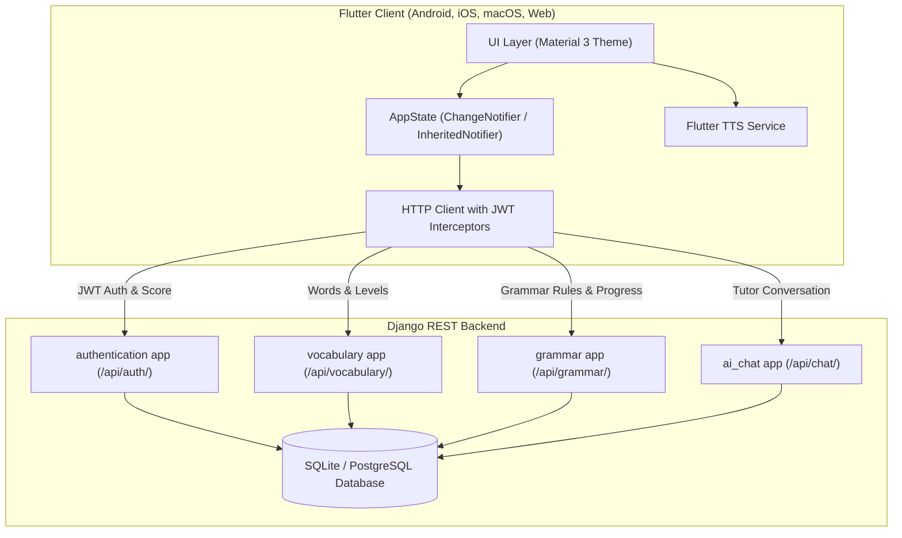

# MasterG 🎓 — AI-Powered English Learning Platform

[](https://github.com/Nitya1520/MasterG/actions/workflows/ci.yml)
[](https://flutter.dev)
[](https://www.djangoproject.com)
[](https://www.python.org)
[](https://opensource.org/licenses/MIT)

MasterG is a modern cross-platform English language acquisition platform designed to accelerate fluency through interactive, gamified learning. It combines structured CEFR vocabulary progression (A1 to C2), comprehensive grammar modules with instant quizzes, timed rapid-fire vocabulary challenges, text-to-speech pronunciation, and an AI-driven conversational English tutor (G-Bot).

---

## 📑 Table of Contents

- [Key Features](#-key-features)
- [System Architecture](#-system-architecture)
- [Project Structure](#-project-structure)
- [Quick Start Guide](#-quick-start-guide)
  - [Prerequisites](#prerequisites)
  - [1. Backend Setup (Django REST Framework)](#1-backend-setup-django-rest-framework)
  - [2. Frontend Setup (Flutter)](#2-frontend-setup-flutter)
- [API Overview](#-api-overview)
- [Testing & Quality Gates](#-testing--quality-gates)
- [Documentation Directory](#-documentation-directory)
- [Contributing](#-contributing)
- [License](#-license)

---

## 🌟 Key Features

- **CEFR Vocabulary Progression**: Structured learning tracks from A1 (Beginner) through C2 (Proficient), complete with English meanings, Gujarati translations, example sentences, and phonetic pronunciation.
- **Audio Pronunciation (TTS)**: Built-in native speech synthesis enables students to listen to clear, natural pronunciation of vocabulary words with a single tap.
- **Grammar Mastery**: 50+ bite-sized grammar units with interactive rule walkthroughs and 5-question verification quizzes.
- **G-Bot AI English Tutor**: Conversational chat assistant that practices realistic dialogues, identifies grammar mistakes, explains English idioms, and encourages regular practice.
- **Rapid Fire Challenge**: 10-word timed translation and spelling drills to build reflex recall.
- **Revision & Flashcards**: Adaptive review sessions tailored to previously studied words and completed grammar topics.
- **Gamification & Leaderboard**: Earn XP points for every completed activity, build daily learning streaks, and compete against peers on the global leaderboard.
- **Guest Exploration Mode**: Instant access for new students to test all learning modules without initial sign-in friction.

---

## 🏛 System Architecture

MasterG is engineered as a decoupled, service-oriented client-server architecture:



For in-depth architectural specifications, see [ARCHITECTURE.md](docs/ARCHITECTURE.md).  
For UI/UX guidelines and design tokens, see [DESIGN.md](docs/DESIGN.md).

---

## 📁 Project Structure

```text
MasterG/
├── .github/                      # CI/CD Workflows, PR templates, and Issue templates
│   ├── workflows/ci.yml          # Automated GitHub Actions test & build pipeline
│   ├── pull_request_template.md  # Standard pull request checklist
│   └── ISSUE_TEMPLATE/           # Structured bug and feature templates
├── docs/                         # Technical architecture and design docs
│   ├── ARCHITECTURE.md           # System design, data flow, ER diagrams
│   ├── DESIGN.md                 # UI/UX design tokens, typography, component specs
│   ├── API.md                    # REST API specifications and schemas
│   └── DEPLOYMENT.md             # Production hosting and containerization guide
├── masterg_api/                  # Backend application (Django REST Framework)
│   ├── api/                      # Django project configuration & top-level routing
│   ├── authentication/           # User authentication, JWT tokens, leaderboard, scoring
│   ├── grammar/                  # Grammar topics, user progress tracking, quizzes
│   ├── vocabulary/               # CEFR words, sentences, daily progress, rapid-fire, revision
│   ├── requirements.txt          # Python dependencies
│   └── manage.py                 # Django CLI management entrypoint
├── masterg_app/                  # Frontend application (Flutter Multi-platform)
│   ├── lib/
│   │   ├── config/               # API endpoint configurations & environment flags
│   │   ├── grammar/              # Grammar screens, models, and service layer
│   │   ├── screens/              # UI screens (Auth, Dashboard, Learn, Chat, Profile)
│   │   ├── state/                # AppState state management
│   │   ├── theme/                # Material 3 design system, themes, and gradients
│   │   └── main.dart             # Application initialization & entrypoint
│   ├── test/                     # Automated Flutter widget & state unit tests
│   └── pubspec.yaml              # Flutter dependencies and assets
├── CONTRIBUTING.md               # Contribution workflow and commit conventions
├── CODE_OF_CONDUCT.md           # Community guidelines (Contributor Covenant 2.1)
├── SECURITY.md                   # Security vulnerability reporting policy
├── LICENSE                       # MIT Open Source License
└── README.md                     # Project documentation (this file)
```

---

## 🚀 Quick Start Guide

### Prerequisites

- **Python**: Version `3.10+` (tested on Python `3.12.4`)
- **Flutter SDK**: Version `3.20+` (tested on Flutter `3.50.0`)
- **Git**
- Optional: Google Gemini API key for live AI conversational tutor

---

### 1. Backend Setup (Django REST Framework)

1. Open your terminal and navigate to `masterg_api`:
   ```bash
   cd masterg_api
   ```
2. Create and activate a Python virtual environment:
   ```bash
   # On macOS / Linux
   python3 -m venv venv
   source venv/bin/activate

   # On Windows
   python -m venv venv
   .\venv\Scripts\activate
   ```
3. Install backend dependencies:
   ```bash
   pip install -r requirements.txt
   ```
4. Run database migrations:
   ```bash
   python api/manage.py migrate
   ```
5. Seed initial vocabulary data (71 words & 355 sentences):
   ```bash
   python api/vocabulary/script.py
   ```
6. Start the local development server:
   ```bash
   python api/manage.py runserver 127.0.0.1:8000
   ```
   The API will be available at `http://127.0.0.1:8000/`.

---

### 2. Frontend Setup (Flutter)

1. In a separate terminal tab, navigate to `masterg_app`:
   ```bash
   cd masterg_app
   ```
2. Fetch Flutter packages:
   ```bash
   flutter pub get
   ```
3. Run the application pointing to your local backend:
   - **For macOS Desktop**:
     ```bash
     flutter run -d macos --dart-define=API_BASE_URL=http://127.0.0.1:8000/api
     ```
   - **For Chrome / Web**:
     ```bash
     flutter run -d chrome --dart-define=API_BASE_URL=http://127.0.0.1:8000/api
     ```
   - **For Android Emulator**:
     ```bash
     flutter run -d android --dart-define=API_BASE_URL=http://10.0.2.2:8000/api
     ```
   - **For iOS Simulator**:
     ```bash
     flutter run -d ios --dart-define=API_BASE_URL=http://127.0.0.1:8000/api
     ```

---

## 🔌 API Overview

All API endpoints are prefixed with `/api/`. Secure endpoints require an `Authorization: Bearer <access_token>` header.

| Endpoint | Method | Auth Required | Description |
| :--- | :---: | :---: | :--- |
| `/api/auth/register/` | `POST` | No | Register new user account with email & password |
| `/api/auth/login/` | `POST` | No | Authenticate user and issue JWT access & refresh tokens |
| `/api/auth/token/refresh/` | `POST` | No | Exchange valid refresh token for a fresh access token |
| `/api/auth/score/` | `POST` | Yes | Submit earned points and update activity counters |
| `/api/auth/leaderboard/` | `GET` | Yes | Fetch top users leaderboard and current user rank |
| `/api/vocabulary/levels/` | `GET` | No | Retrieve learned word counts across CEFR levels A1–C2 |
| `/api/vocabulary/current-word/` | `GET` | No | Get the current word details for a given CEFR level |
| `/api/vocabulary/next-word/` | `POST` | No | Advance word pointer, award XP, and update daily streak |
| `/api/vocabulary/rapid-fire/words/` | `POST` | Yes | Fetch 10 random vocabulary word pairs for rapid challenge |
| `/api/vocabulary/revision/` | `GET` | Yes | Fetch personalized review words and completed grammar topics |
| `/api/vocabulary/profile/` | `GET` | No | Fetch user stats, streak, points, and daily goal progress |
| `/api/grammar/progress/` | `GET` | Yes | Retrieve completed grammar topic IDs and points |
| `/api/grammar/complete/` | `POST` | Yes | Submit 5/5 quiz completion for a grammar topic (+10 points) |
| `/api/chat/` | `POST` | Yes | Conversational English practice with G-Bot tutor |

For full request/response schemas and examples, see [docs/API.md](docs/API.md).

---

## 🧪 Testing & Quality Gates

MasterG includes automated test suites across both backend and frontend layers:

### Running Backend Tests
```bash
cd masterg_api
python api/manage.py test authentication grammar vocabulary
```

### Running Frontend Tests & Analysis
```bash
cd masterg_app
flutter analyze
flutter test
```

### Building Release Packages
```bash
# Web
cd masterg_app && flutter build web

# Android
cd masterg_app && flutter build apk --release

# macOS
cd masterg_app && flutter build macos --release
```

---

## 📚 Documentation Directory

- 📐 **[Architecture Document](docs/ARCHITECTURE.md)**: Deep technical architecture, component diagrams, database ER model, and data flow.
- 🎨 **[Design System & UI/UX](docs/DESIGN.md)**: Color theory, typography, spacing tokens, and accessibility standards.
- 📡 **[REST API Reference](docs/API.md)**: Complete request/response schemas, status codes, and error formats.
- 🚢 **[Deployment Guide](docs/DEPLOYMENT.md)**: Production guide covering Docker, Gunicorn, Nginx, PostgreSQL, and static hosting.

---

## 🤝 Contributing

We welcome contributions to MasterG! Please check out [CONTRIBUTING.md](CONTRIBUTING.md) for branch naming standards, conventional commit guidelines, and pull request procedures.

---

## 📄 License

This project is licensed under the terms of the [MIT License](LICENSE).
