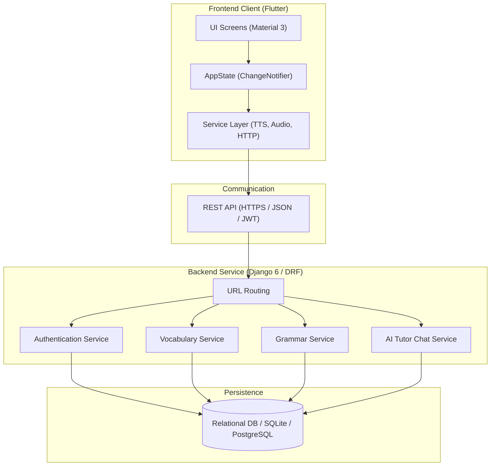
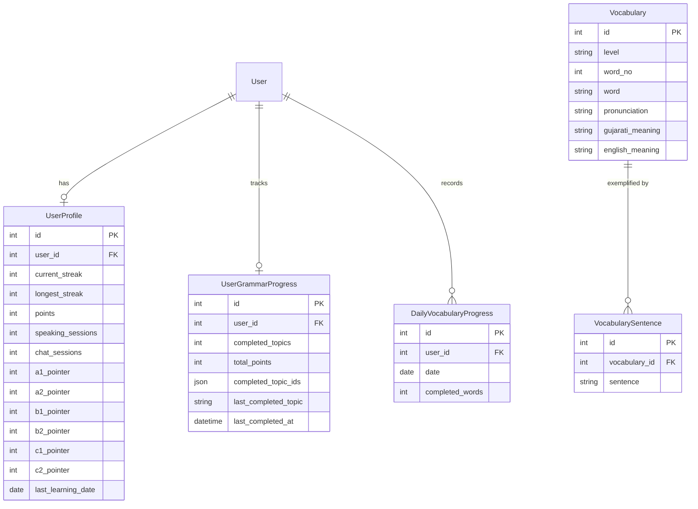
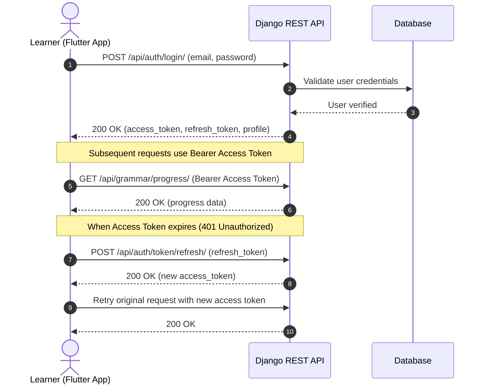

# MasterG Architecture Specification

This document provides a technical overview of the MasterG system architecture, encompassing the frontend Flutter client, the backend Django REST service, data persistence models, and security considerations.

---

## 1. High-Level System Architecture

MasterG employs a client-server architecture with separation between presentation, state orchestration, business logic, and relational persistence.

---

## 2. Component Breakdown

### 2.1 Frontend Architecture (`masterg_app`)
- **UI Screens**: Modular screens organised by domain:
  - `screens/auth/`: User registration and authentication views.
  - `screens/dashboard/`: Main hub presenting daily goals, active streaks, and entry points.
  - `screens/learn/`: Learning modules (CEFR word learning, Rapid Fire, Revision, Grammar Quizzes).
  - `screens/chat/`: Real-time AI chat with voice recognition and speech playback.
  - `screens/profile/`: Progress tracking, leaderboard standings, and settings.
- **Navigation Shell**: `MainNavigationShell` utilizes an `IndexedStack` to preserve state, scroll coordinates, and network caches across tab switches.
- **State Management**: Built on `InheritedNotifier` (`AppStateProvider`) backed by a centralized `AppState` class controlling authentication tokens, daily goal metrics, streak records, and caching.
- **Audio Subsystem**:
  - `SpeechToText`: Converts learner speech into text for conversational turns.
  - `FlutterTts`: Synthesizes spoken English for vocabulary pronunciation and tutor replies.

### 2.2 Backend Architecture (`masterg_api`)
- **Django REST Framework**: Handles endpoint routing, request validation, serialization, and permissions.
- **JWT Authentication**: Powered by `rest_framework_simplejwt`, issuing short-lived access tokens and longer-lived refresh tokens.
- **Domain Modules**:
  - `authentication`: User registration, session verification, dynamic leaderboard calculation, and point recording.
  - `vocabulary`: CEFR levels (A1-C2), sequential word pointers, example sentences, daily progress trackers, rapid-fire generation, and review sets.
  - `grammar`: Topic completion validation, 5/5 score gate enforcement, and topic mastery recording.
  - `api/chat`: English conversational engine evaluating grammar, providing corrections, and connecting to Gemini API when configured.

---

## 3. Database Entity-Relationship Model

---

## 4. Authentication and Token Refresh Flow

---

## 5. Security & Data Protection

- **Password Storage**: Passwords are saved using PBKDF2 with SHA-256 password hashing.
- **JWT Protection**: Tokens are signed with HMAC-SHA256.
- **Cross-Origin Resource Sharing (CORS)**: Controlled through `django-cors-headers`. In production, origins should be restricted to trusted application domains.
- **Database Safety**: SQL injection prevention is guaranteed through the Django ORM query parameterization.
