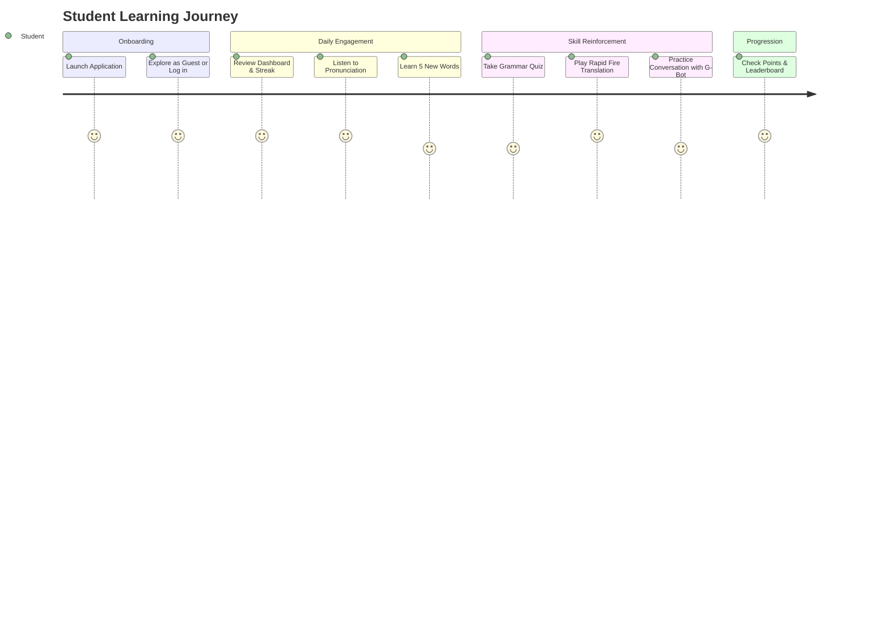

# MasterG Design System & UI/UX Specification

This document details the visual language, design tokens, component architecture, and accessibility principles employed across MasterG.

---

## 1. Design Philosophy

MasterG follows modern Material 3 design principles with tailored visual enhancements:
- **Gamified Clarity**: Clean progress indicators, daily streak flame badges, and XP reward counters motivate consistent practice.
- **Cognitive Ease**: High-contrast typography and clear phonetic transcriptions minimize learner anxiety.
- **Multimodal Feedback**: Visual cues, animated state transitions, and audio pronunciation provide reinforcement.

---

## 2. Color Palette & Gradients

The interface utilizes a purposeful color scheme supporting light and dark themes:

### Primary Colors
- **Primary Indigo**: `#6366F1` (Action buttons, active indicators, brand emphasis)
- **Secondary Purple**: `#8B5CF6` (Accents, gradients, module borders)
- **Tertiary Rose**: `#EC4899` (Badges, special achievements)

### Semantic Gradients
- **Primary Gradient**: Linear `0xFF6366F1` to `0xFF8B5CF6` (Buttons, hero cards)
- **Flame / Streak Gradient**: Linear `0xFFF97316` to `0xFFEF4444` (Daily streak counters)
- **Gold / XP Gradient**: Linear `0xFFF59E0B` to `0xFFD97706` (Leaderboard rankings)
- **Success Gradient**: Linear `0xFF10B981` to `0xFF059669` (Quiz completion, correct answers)

### Surface & Neutral Tones
- **Light Theme Background**: `#F8FAFC` (Slate 50)
- **Light Theme Surface**: `#FFFFFF` with border `#E2E8F0`
- **Dark Theme Background**: `#0F172A` (Slate 900)
- **Dark Theme Surface**: `#1E293B` (Slate 800)

---

## 3. Typography Hierarchy

The typography scale balances readability across compact mobile displays and large desktop screens:

| Style | Size | Weight | Usage |
| :--- | :---: | :---: | :--- |
| **Display / Hero** | 34sp | Bold (700) | Vocabulary word presentation |
| **Headline Medium** | 24sp | Bold (700) | Screen headers, greeting |
| **Title Medium** | 18sp | SemiBold (600) | Card titles, module names |
| **Body Large** | 16sp | Regular (400) | Sentences, tutor chat text |
| **Body Medium** | 14sp | Medium (500) | Translations, explanations |
| **Label Small** | 11sp | Bold (700) | CEFR level tags, category badges |

---

## 4. Design Tokens & Shape Standards

```dart
static const double cardRadius = 22.0;
static const double buttonRadius = 14.0;
static const double inputRadius = 14.0;

static final BorderRadius cardBorderRadius = BorderRadius.circular(cardRadius);
static final BorderRadius buttonBorderRadius = BorderRadius.circular(buttonRadius);
static final BorderRadius inputBorderRadius = BorderRadius.circular(inputRadius);
```

- **Elevation**: Elevated components rely on diffuse colored box shadows (`0 8px 20px rgba(99, 102, 241, 0.08)`) rather than rigid Material 2 elevations.
- **Touch Targets**: All interactive elements (speaker button, next word button, option chips) maintain a minimum target size of 48x48dp.

---

## 5. Screen Layout & User Journey



---

## 6. Accessibility & Inclusivity (a11y)

- **Text-to-Speech Integration**: Pronunciation is supported via `FlutterTts` with a dedicated, high-contrast speaker button.
- **Clear Contrast Ratios**: All text elements meet WCAG AA standards (minimum 4.5:1 for body copy).
- **Haptic & Visual Feedback**: Correct answers, error notices, and daily completions provide clear color shifts, snackbars, and animated celebrations.
- **Multilingual Clarity**: Dual-language display provides English phonetic transliteration alongside native Gujarati script to eliminate vocabulary ambiguity.
